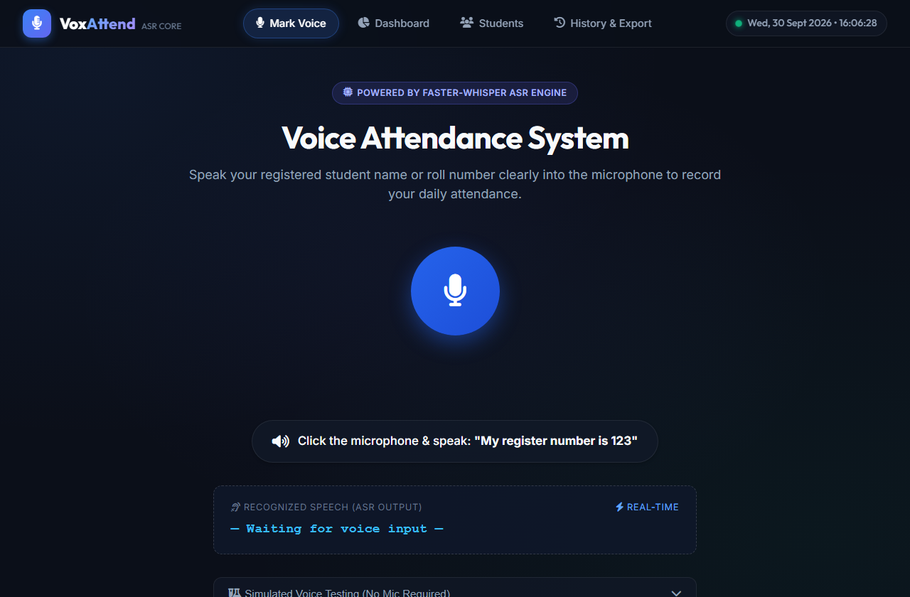
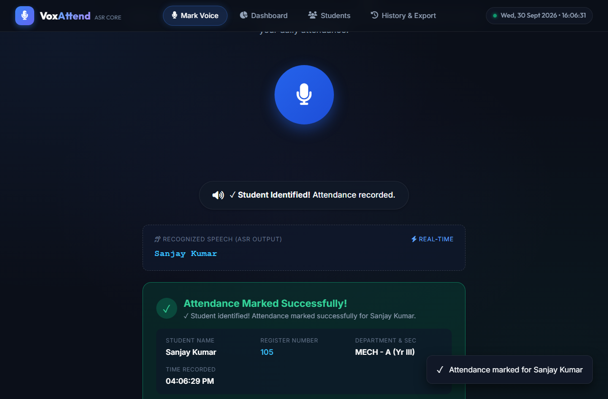
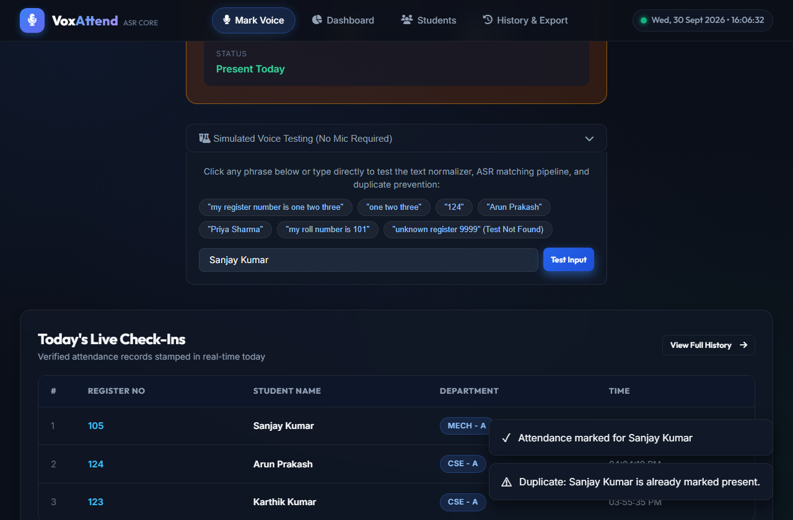
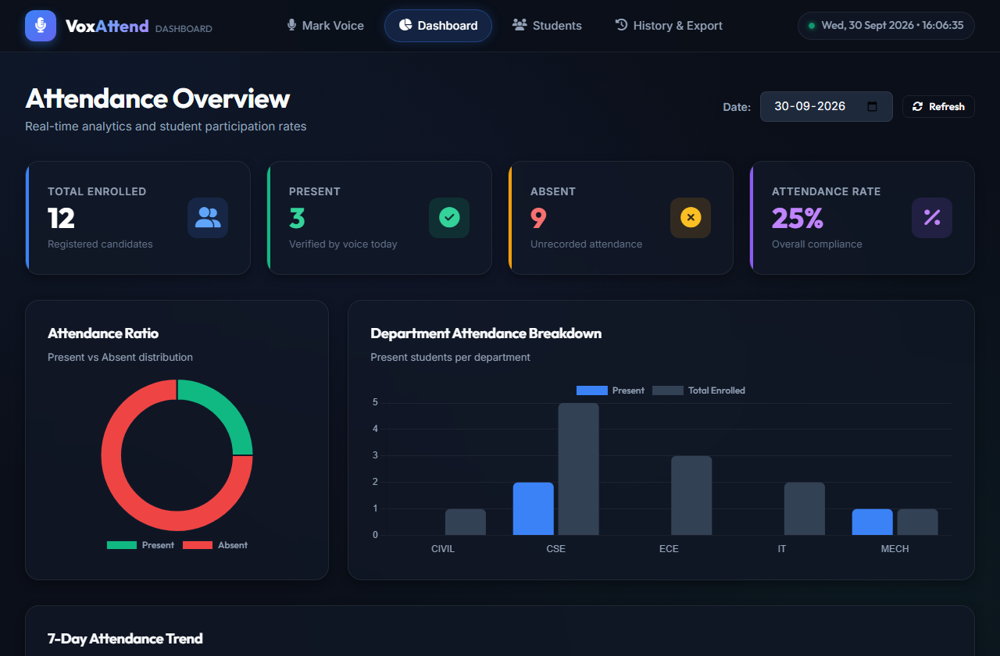
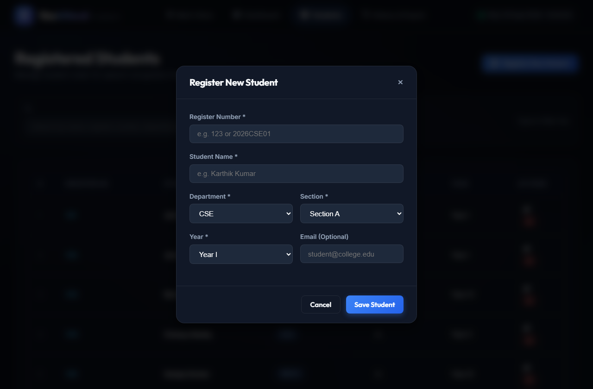
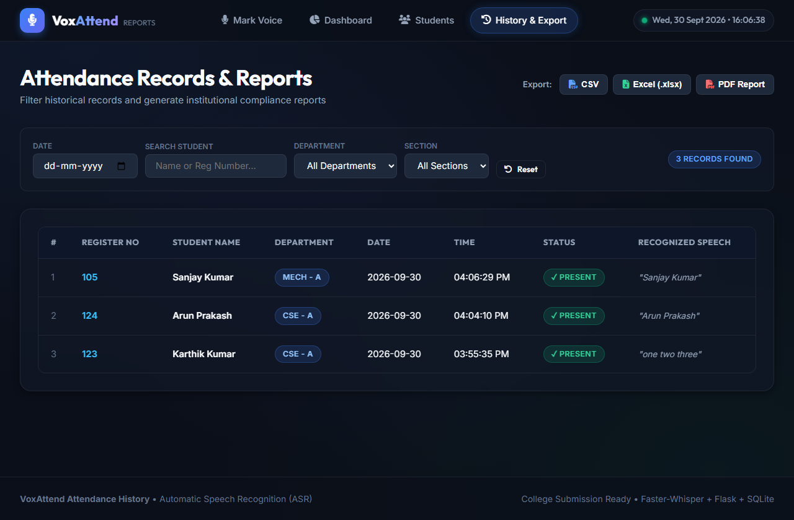

# Voice Attendance System – Automatic Speech Recognition (ASR) Project

[](https://www.python.org/)
[](https://flask.palletsprojects.com/)
[](https://github.com/SYSTRAN/faster-whisper)
[](LICENSE)

An institutional-grade, privacy-conscious **Voice Attendance System** powered by state-of-the-art **Automatic Speech Recognition (ASR)** using Faster-Whisper. Students mark daily attendance hands-free by speaking their registered name or roll number into a browser microphone. The system transcribes audio, normalizes colloquial number words, matches student identity against an SQLite database, enforces daily duplicate prevention, and provides real-time admin analytics and multi-format reports (CSV, Excel, PDF).

---

## Table of Contents

1. [Problem Statement](#problem-statement)
2. [Project Objectives](#project-objectives)
3. [Key Features](#key-features)
4. [System Architecture](#system-architecture)
5. [ASR Workflow & Normalization Pipeline](#asr-workflow--normalization-pipeline)
6. [Technology Stack](#technology-stack)
7. [Database Schema](#database-schema)
8. [Installation & Setup](#installation--setup)
9. [How to Run](#how-to-run)
10. [Test Suite](#test-suite)
11. [Screenshots & UI Walkthrough](#screenshots--ui-walkthrough)
12. [Future Enhancements](#future-enhancements)
13. [Contributors & License](#contributors--license)

---

## Problem Statement

Traditional manual attendance methods (roll calls and physical sign-in sheets) are time-consuming, prone to proxy attendance, and inefficient in large classrooms. While biometric fingerprint scanners solve some issues, they cause hygiene concerns, hardware bottlenecks, and maintenance overhead. 

The **Voice Attendance System** addresses these challenges by utilizing modern offline Automatic Speech Recognition (ASR). Students speak naturally (e.g., *"My register number is 123"* or *"one two three"* or *"Arun Prakash"*), allowing rapid contactless identification with instant duplicate validation.

---

## Project Objectives

* **Contactless & Fast**: Mark attendance within seconds using spoken student identifiers.
* **Open-Source Local ASR**: Utilize **Faster-Whisper** for fast, high-accuracy, privacy-preserving transcription without sending private student audio to third-party proprietary APIs.
* **Robust Text Normalization**: Convert conversational speech patterns, filler words, and spoken word numbers (*"one two three"* $\to$ `123`) into valid database keys.
* **Strict Integrity & Duplicate Prevention**: Enforce database-level and application-level constraints preventing multiple check-ins on the same calendar day.
* **Comprehensive Analytics & Export**: Real-time admin dashboard with participation rates, department breakdown, and one-click export to CSV, Excel (`.xlsx`), and PDF.

---

## Key Features

### 1. Student Voice Check-in
* Prominent, glowing microphone interface with animated soundwave rings.
* Real-time audio waveform visualizer using the HTML5 Web Audio API.
* In-browser pure 16kHz PCM WAV encoding for consistent cross-browser audio quality.
* Auditory feedback (chimes for success, warning beeps for duplicate attempts).
* Simulated voice input accordion for testing without requiring a physical microphone.

### 2. ASR Engine & Speech Processing
* Uses **Faster-Whisper** (`tiny.en` / `base.en`) with int8 quantization for low-latency CPU inference.
* RMS energy silence detection to filter empty or ambient room noise.
* Fallback to SpeechRecognition and resilient multi-container decoding via PyAV and libsndfile.

### 3. Smart Text Normalization & Matching
* Strips conversational filler phrases:
  * *"my register number is"*
  * *"my roll number is"*
  * *"my ID is"*
  * *"register number / roll number / present sir"*
* Converts number words:
  * *"one two three"* $\to$ `"123"`
  * *"one zero one"* $\to$ `"101"`
  * *"twenty four"* $\to$ `"24"`
  * *"double five"* $\to$ `"55"`
* Multi-tier identification: Exact register number $\to$ Substring register code $\to$ Exact full name $\to$ Token & fuzzy string matching.

### 4. Duplicate Check-in Prevention
* Strict `UNIQUE(student_id, date)` constraint in SQLite.
* Immediate warning with timestamp of previous check-in if a student attempts duplicate check-in on the same day.

### 5. Admin Dashboard & Analytics
* Summary KPIs: Total Enrolled, Present Today, Absent Today, Attendance Percentage.
* Interactive **Chart.js** charts:
  * Attendance Ratio Doughnut Chart.
  * Department Attendance Bar Chart.
  * 7-Day Trend Line Chart.
* Real-time log of today's verified check-ins.

### 6. Student Roster Management
* Full CRUD for student registrations: Name, Register Number, Department, Section, Year, and Email.
* Live instant search filter by name or register number.

### 7. Historical Reports & Multi-Format Export
* Multi-criteria filtering: Date picker, student query, department dropdown, and section filter.
* **Export as CSV**: Clean UTF-8 format.
* **Export as Excel (.xlsx)**: Formatted table with headers, borders, and column autosizing via `openpyxl`.
* **Export as PDF**: Formatted institutional report via `reportlab`.

---

## System Architecture

```text
+-----------------------------------------------------------------------+
|                             USER BROWSER                              |
|                                                                       |
|  [ Microphne Input ]  -->  Web Audio API (16kHz PCM WAV Encoder)      |
|           |                                 |                         |
|  [ UI Visualizer ]   <--  AnalyserNode      | (POST /api/voice-attend)|
+-----------|---------------------------------|-------------------------+
            |                                 v
+-----------|-----------------------------------------------------------+
|           |                 FLASK BACKEND (app.py)                    |
|           |                                                           |
|           |   1. Decode Audio (PyAV / soundfile / wave)               |
|           |   2. Silence / Energy Check (RMS energy < 0.0025)         |
|           |   3. Faster-Whisper ASR Engine (WhisperModel tiny.en)     |
|           |          |                                                |
|           |          v (Raw Transcription)                            |
|           |   4. Text Normalizer (utils/text_normalizer.py)           |
|           |          - Strip prefixes ("my register number is")       |
|           |          - Word to Digits ("one two three" -> "123")      |
|           |          |                                                |
|           |          v (Candidate ID & Name)                          |
|           |   5. Student Identification & Duplicate Validation        |
|           |          |                                                |
|           +--------->|  Check: UNIQUE(student_id, date)               |
|                      |  Insert: Attendance Record                     |
|                      v                                                |
|             JSON Response { success, student, attendance }            |
+-----------------------------------------------------------------------+
                               |
                               v
                     +-------------------+
                     |   SQLite (db)     |
                     |  - students       |
                     |  - attendance     |
                     +-------------------+
```

---

## ASR Workflow & Normalization Pipeline

```text
Student speaks: "My register number is one two three"
                    ↓
[Browser] Captures 16kHz mono audio via getUserMedia & PCM recorder
                    ↓
[Backend] Faster-Whisper transcribes speech:
          Raw text: "My register number is one two three"
                    ↓
[Normalizer]
  Step 1: Strip filler phrases: "one two three"
  Step 2: Word to digit conversion: "123"
  Step 3: Extract candidates: ['123']
                    ↓
[Database Match]
  Query: SELECT * FROM students WHERE register_number = '123'
  Result: Found "Karthik Kumar" (CSE - Section A - Year III)
                    ↓
[Duplicate Check]
  Query: SELECT * FROM attendance WHERE student_id = ? AND date = ?
  Case A (Not marked yet): INSERT INTO attendance ... -> Returns 200 OK
  Case B (Already marked): Returns 200 Duplicate Alert
```

---

## Technology Stack

| Layer | Technologies |
|---|---|
| **Frontend** | HTML5, CSS3 (Modern Glassmorphism Design System), JavaScript (ES6+), Web Audio API |
| **Icons & Fonts** | Font Awesome 6, Google Fonts (`Outfit`, `Inter`) |
| **Data Visuals** | Chart.js 4.4 |
| **Backend** | Python 3.10+, Flask 3.x, Werkzeug |
| **ASR Engine** | Faster-Whisper (CTranslate2), SpeechRecognition |
| **Audio Processing**| PyAV (`av`), `soundfile`, Python `wave`, `numpy` |
| **Database** | SQLite3 (Parameterized SQL, Foreign Keys, Unique Constraints) |
| **Reporting** | `openpyxl` (Excel), `reportlab` (PDF), Python `csv` |
| **Testing** | Python `unittest` |

---

## Database Schema

```sql
-- Students Table
CREATE TABLE students (
    id INTEGER PRIMARY KEY AUTOINCREMENT,
    register_number TEXT UNIQUE NOT NULL,
    name TEXT NOT NULL,
    department TEXT NOT NULL,
    section TEXT NOT NULL,
    year TEXT NOT NULL,
    email TEXT,
    created_at TIMESTAMP DEFAULT CURRENT_TIMESTAMP
);

-- Attendance Table
CREATE TABLE attendance (
    id INTEGER PRIMARY KEY AUTOINCREMENT,
    student_id INTEGER NOT NULL,
    date TEXT NOT NULL,            -- Formatted YYYY-MM-DD
    time TEXT NOT NULL,            -- Formatted HH:MM:SS AM/PM
    status TEXT NOT NULL DEFAULT 'Present',
    recognized_text TEXT,
    created_at TIMESTAMP DEFAULT CURRENT_TIMESTAMP,
    FOREIGN KEY (student_id) REFERENCES students(id) ON DELETE CASCADE,
    UNIQUE (student_id, date)      -- Strict duplicate prevention constraint
);
```

---

## Project Structure

```text
voice-attendance/
│
├── app.py                     # Main Flask application & API routes
├── requirements.txt           # Python package dependencies
├── README.md                  # Comprehensive project documentation
├── .gitignore                 # Excluded environments and caches
│
├── database/
│   ├── attendance.db          # SQLite database (auto-created on startup)
│   └── db.py                  # Database connection, queries, constraints & seeding
│
├── asr/
│   └── speech_recognizer.py   # Faster-Whisper wrapper, decoding & silence detection
│
├── utils/
│   ├── text_normalizer.py     # Number word conversion & student matching
│   └── export_helpers.py      # CSV, Excel (.xlsx), and PDF generators
│
├── templates/
│   ├── index.html             # Voice Attendance Home interface
│   ├── dashboard.html         # Admin Analytics & Visualizations
│   ├── students.html          # Student Registration & Roster
│   └── attendance.html        # Filterable Attendance History & Export
│
├── static/
│   ├── css/
│   │   └── style.css          # Master responsive stylesheet
│   └── js/
│       └── script.js          # Web Audio recorder, visualizer & API controller
│
├── uploads/
│   └── .gitkeep               # Directory for temporary audio processing
│
└── tests/
    └── test_attendance.py     # Comprehensive 12-scenario unit test suite
```

---

## Installation & Setup

### 1. Clone the Repository
```bash
git clone https://github.com/your-username/voice-attendance.git
cd voice-attendance
```

### 2. Create and Activate Virtual Environment
* **On Windows (PowerShell / Command Prompt)**:
  ```powershell
  python -m venv venv
  .\venv\Scripts\activate
  ```
* **On macOS / Linux**:
  ```bash
  python3 -m venv venv
  source venv/bin/activate
  ```

### 3. Install Dependencies
```bash
pip install -r requirements.txt
```

---

## How to Run

### 1. Launch the Application
```bash
python app.py
```

### 2. Open in Browser
Navigate to:
```text
http://127.0.0.1:5000
```

### Default Sample Students Seeded:
| Register No | Name | Department | Section | Spoken Sample |
|---|---|---|---|---|
| `123` | Karthik Kumar | CSE | A | *"My register number is 123"* |
| `124` | Arun Prakash | CSE | A | *"One two four"* |
| `125` | Priya Sharma | ECE | B | *"Priya Sharma"* |
| `101` | John Doe | CSE | A | *"101"* |
| `102` | Jane Smith | CSE | B | *"Jane Smith"* |

---

## Test Suite

The project includes an automated test suite verifying all 12 core scenarios:

1. **Clear student name** (e.g., *"Karthik Kumar"*)
2. **Spoken register number** (e.g., *"124"*)
3. **Conversational sentence** (*"My register number is 123"*)
4. **Number word conversion** (*"one two three"* $\to$ `123`)
5. **Unknown register number rejection** (*"99999"*)
6. **Duplicate attendance prevention** (Second attempt on same day blocked)
7. **Empty speech / silence handling**
8. **Microphone permission denied / invalid audio handling**
9. **Conversational noise and filler words handling**
10. **Multiple students batch check-ins**
11. **Different pronunciation and fuzzy matching**
12. **Attendance report export validation** (CSV, Excel `.xlsx`, PDF)

### Running Tests:
```bash
python -m unittest tests/test_attendance.py
```

Expected output:
```text
............
----------------------------------------------------------------------
Ran 12 tests in 0.973s

OK
```

---

## Screenshots & UI Walkthrough

### 1. Voice Attendance Interface (`/`)
Interactive microphone hub with pulsating rings, live Web Audio API waveform visualizer, and real-time status output.



---

### 2. Live Verification & Attendance Marked
Instant ASR transcription with Faster-Whisper, colloquial number-to-digit conversion, student matching, and attendance timestamp verification.



---

### 3. Duplicate Attendance Prevention Alert
Strict daily check-in validation. If a student attempts to mark attendance again on the same calendar day, an immediate warning banner and previous record timestamp are displayed.



---

### 4. Admin Analytics Dashboard (`/dashboard`)
Real-time KPI metric cards (Total Enrolled, Present, Absent, Attendance Rate) with interactive Chart.js doughnut chart, department distribution bar graph, and 7-day trend analysis.



---

### 5. Student Roster Management & Modal (`/students`)
Instant search filter across names, register numbers, and departments with student registration and edit modal dialog.



---

### 6. Historical Attendance Records & Multi-Format Export (`/attendance`)
Multi-criteria filtering by Date, Student Name, Register Number, Department, and Section with 1-click export to **CSV**, **Excel (.xlsx)**, and **Printable PDF**.



---

## Future Enhancements

* **Multi-Language ASR**: Expand recognition to regional languages (e.g., Tamil, Hindi, Telugu).
* **Speaker Diarization / Voice Biometrics**: Combine speech recognition with acoustic voiceprint authentication for anti-spoofing.
* **Multimodal Face + Voice Verification**: Two-factor biometric attendance fusing camera facial recognition with voice identification.
* **Mobile Application**: Native Android / iOS application using Flutter or React Native.
* **Automated Parent & Student Notifications**: Integration with SMS/WhatsApp gateways or institutional emails to alert parents of absences.
* **Classroom Smart Speaker Deployment**: Edge deployment on Raspberry Pi devices with directional array microphones for live automated classroom attendance.

---

## Contributors

* **Antigravity ASR Team** – Full Stack & Speech Recognition Engineering

---

## License

This project is licensed under the **MIT License**. See the [LICENSE](LICENSE) file for full details.
